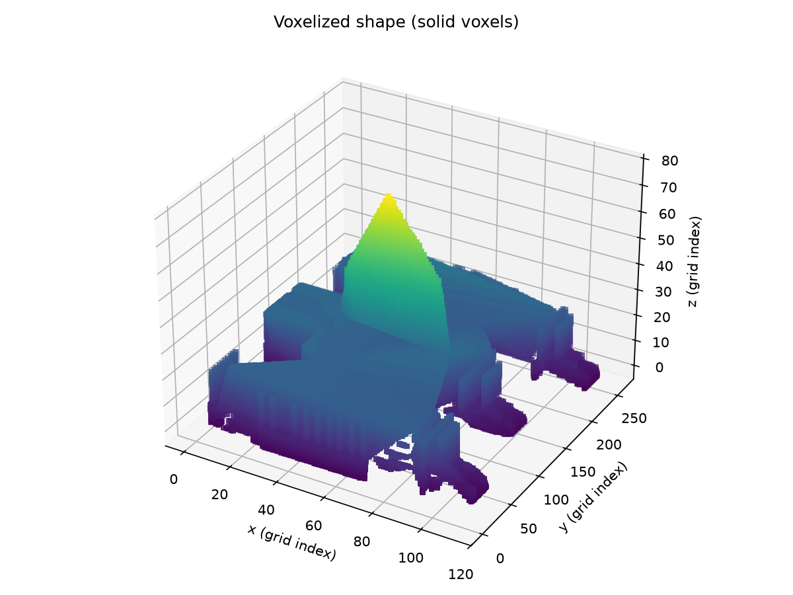
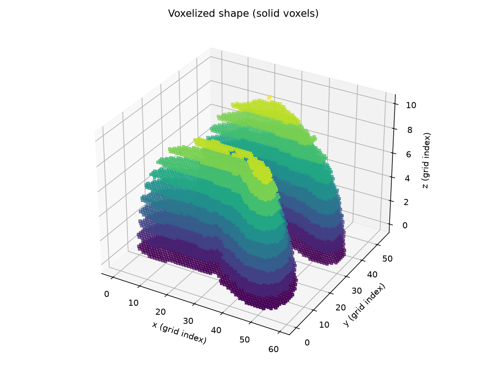
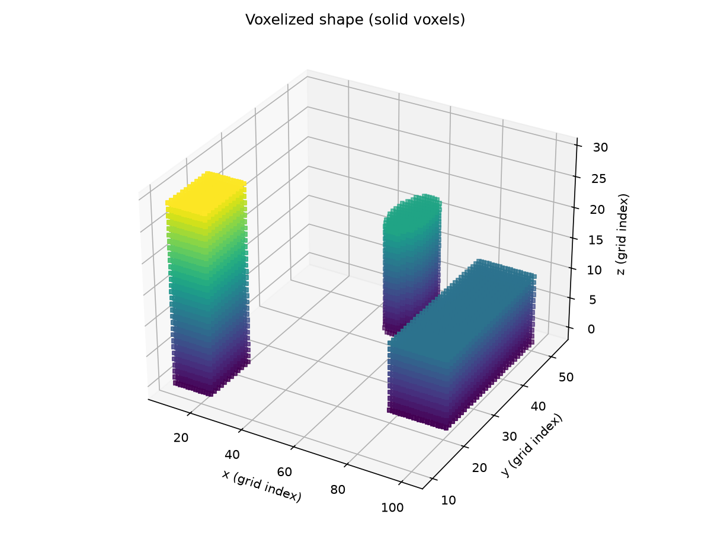
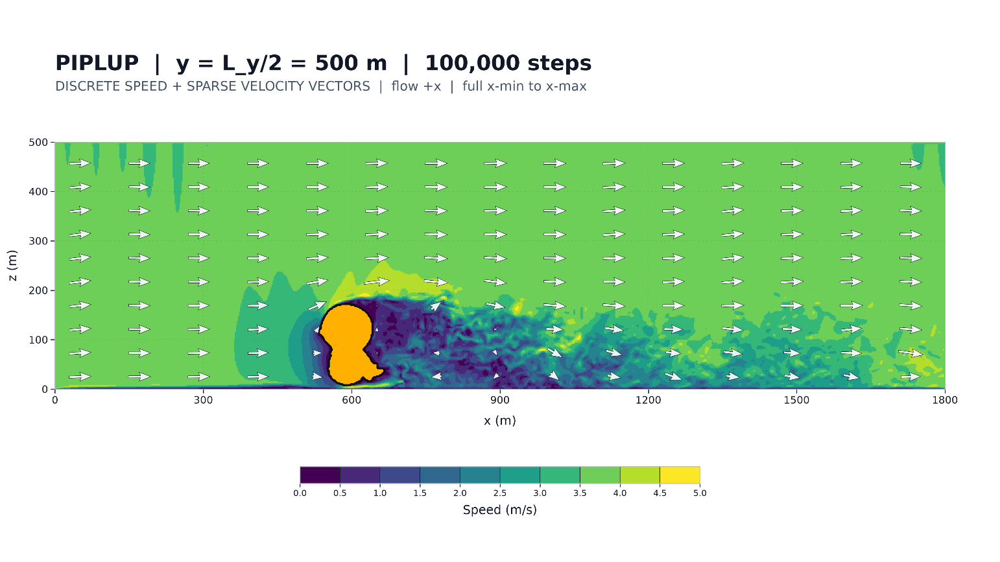
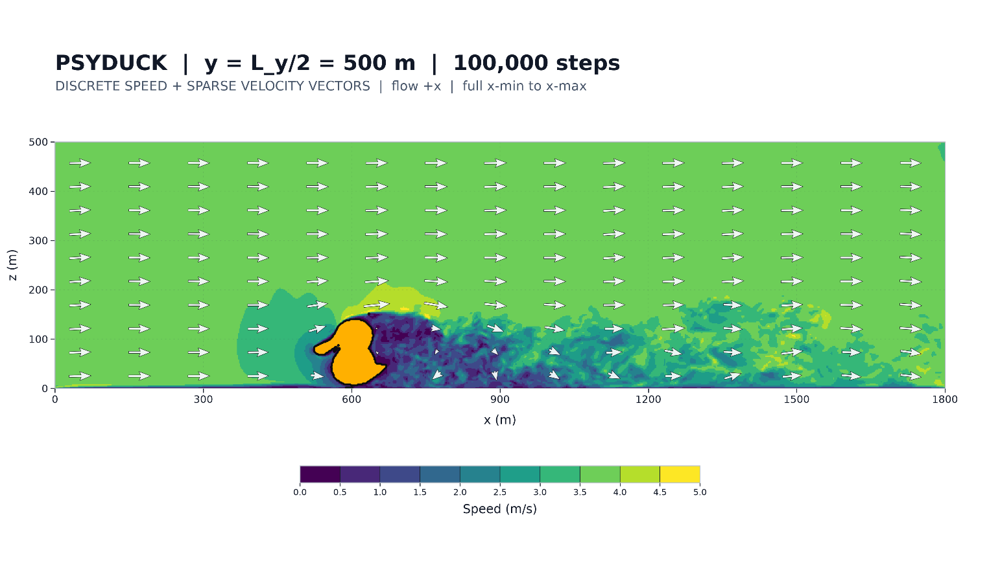
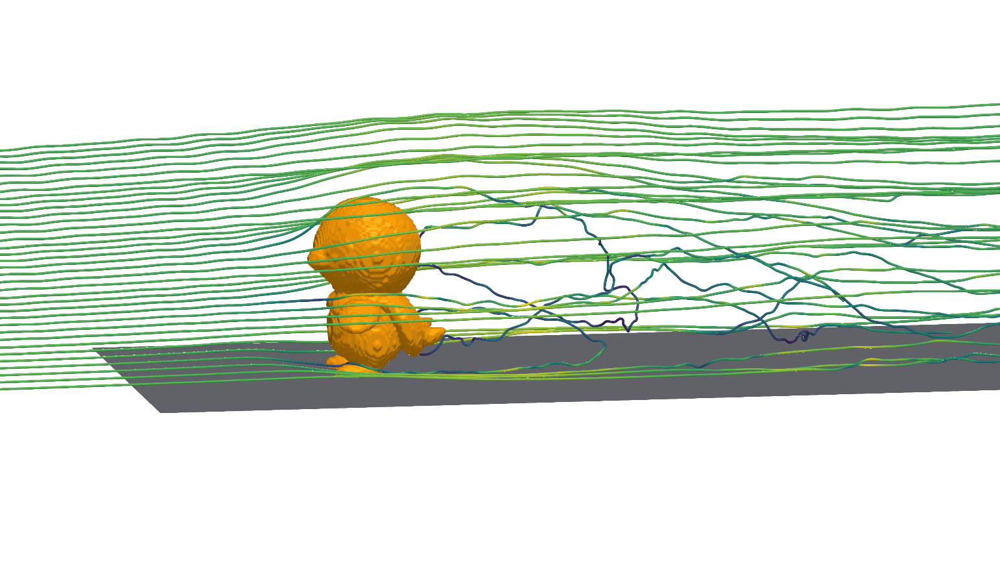
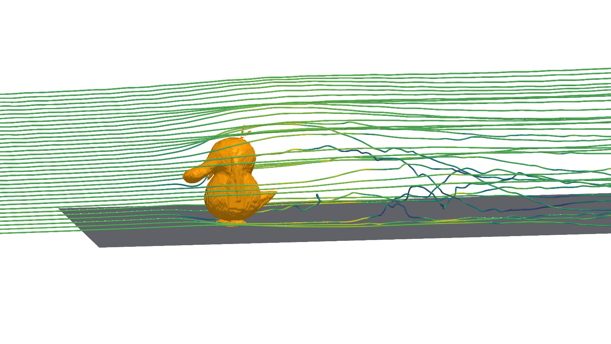
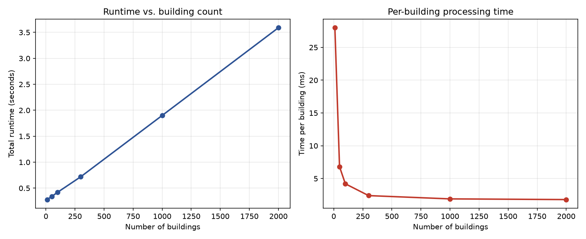

# stl-raw-geometry-pipeline

A preprocessing pipeline that converts STL / CAD (STEP) geometry into the voxel input format used by a GPU Lattice Boltzmann (LBM) urban wind solver: a headerless `uint8` grid where every cell is marked fluid (`0`) or solid (`1`).

Built during a research internship at [**Nuclear Energy System Laboratory (ESLAB)**](https://snueslab.com), Dept. of Nuclear Engineering, Seoul National University (Summer 2026). 

📄 [Final presentation at ESLAB (Aug 2026, PDF)](docs/ESLAB_presentation_2026-08.pdf)

<p align="center">
  
  
  
</p>

---

## Why this exists

The lab's GPU LBM solver simulates wind flow through cities on a 3D grid. Before it can run, every grid cell has to be classified as air or building. Until now that geometry came from **OpenStreetMap (OSM)**, which stores building footprints plus a height or floor count. That works well for whole neighborhoods, but it has hard limits:

- Buildings with missing height data fall back to a default value.
- Curved surfaces and complex roofs can't be represented at all.
- Anything not on the map (a proposed design, an experimental obstacle) can't be input.

This pipeline doesn't replace OSM. It **fills those gaps**: any watertight STL or STEP model can be scaled to real-world size, oriented, placed, and converted into exactly the same format the solver already reads.

## The RAW format

| Property | Value |
|---|---|
| dtype | `uint8` |
| values | `0` = fluid, `1` = solid |
| storage order | C-order, **z fastest** |
| linear index | `index = z + nz * (y + ny * x)` |
| header | none (file size is exactly `nx * ny * nz` bytes) |

Why a headerless byte array instead of handing the solver a mesh: the solver only ever asks "is this cell solid?", millions of times per step. Converting once ahead of time means the solver stays format-agnostic and can load the grid with a single `fread` straight into GPU memory.

Because the file has no header, grid dimensions, pitch, and origin must be agreed on out of band. The pipeline prints them at the end of every run.

## Pipeline

```
STL / STEP
  → load_mesh            read geometry (STEP via cascadio; units auto-converted)
  → simplify_if_needed   quadric decimation above --max-faces
  → orient_mesh          --facing preset or explicit --rotate-x/y/z
  → scale_mesh           uniform scale so one axis matches --target-height (m)
  → define_grid          pitch from --pitch or derived from --target-cells
  → voxelize_mesh        ray-cast inside/outside test at every cell center
  → write_raw            uint8, z-fastest, no header
  → verify_raw           read back: exact byte count, values ∈ {0, 1}
```

The transform order is fixed (**rotate → scale → define grid**) so the bounding box used to build the grid always reflects the final geometry.

**Inside/outside test.** For each cell center, a ray is cast and its crossings with the mesh surface are counted: odd means inside (solid), even means outside (fluid). This requires a watertight mesh; the pipeline checks and warns when it isn't.

## Usage

```bash
pip install -r requirements.txt   # embreex is strongly recommended, see "Engineering notes"
```

**Single object**

```bash
python src/main.py <input.stl|.step> <output.raw> (--pitch P | --target-cells N) \
    [--target-height H] [--scale-axis {x,y,z}] \
    [--facing {posx,negx,posy,negy} | --rotate-x D --rotate-y D --rotate-z D] \
    [--max-faces N] [--visualize]
```

Example (rotate to face −y, scale to 34,000 units along x, fit the longest axis to 40 cells):

```bash
python src/main.py examples/inputs/eros.stl eros.raw \
    --facing negy --target-height 34000 --scale-axis x --target-cells 40 --visualize
```

**Multiple buildings in one domain**

```bash
cd examples/inputs
python ../../src/multi_domain.py city_config.json city.raw --visualize
```

```json
{
  "domain": { "size_m": [120, 100, 40], "pitch": 1 },
  "buildings": [
    { "stl": "building_tower.stl",    "position_m": [10, 10, 0], "target_height": 30 },
    { "stl": "building_cylinder.stl", "position_m": [50, 40, 0], "target_height": 18 },
    { "stl": "building_wide.stl",     "position_m": [80, 20, 0], "target_height": 12, "facing": "posy" }
  ]
}
```

Each building is rotated, scaled, and placed with its footprint corner at `position_m`, resting on the ground. It is then voxelized **only within the slice of the domain its bounding box overlaps**, and OR-combined into the shared grid. STL paths are resolved relative to the current working directory.

**Reading the output from C**

```bash
gcc -o read_raw src/read_raw.c
./read_raw city.raw 120 100 40
```

## Validation

| Check | What it shows | Result |
|---|---|---|
| Synthetic 3-box shape | Solid volume matches a hand calculation | match |
| Small test arrays | Byte order is z-fastest as specified | match |
| Real 40 MB solver input (400×400×250) | Reader handles production-size files | OK |
| NASA Eros asteroid | End-to-end run on a complex natural shape | 35.87% solid |
| U.S. Capitol (37,142 faces) | Dome and wings reproduced at 114×265×78 | 313,994 solid voxels |
| **Independent C re-implementation** | Python and C read the same file identically | **313,994 = 313,994** |
| Eros + rotate + scale + target-cells | All transform options combined | grid (37, 40, 8), 33.15% solid |
| 3 buildings in one domain | Placement, rotation, OR-merge | 16,164 / 480,000 solid (3.37%), round-trip OK |

The C check matters most: it confirms the file is consumable by a C/CUDA solver exactly as the Python side intended, not just readable by the same library that wrote it.

## Solver integration

<p align="center">
  
  
</p>
<p align="center">
  
  
</p>
<p align="center"><em>Top: velocity magnitude at the y = Ly/2 cross-section. Bottom: 3D streamlines. Wind enters from the left.</em></p>

1. **First validation.** A generated RAW file was fed into the lab's Urban-LBM solver and produced physically sensible velocity fields and streamlines. The core STL → RAW function was approved at this stage.
2. **Production-scale run.** Two test shapes, scaled to 170 m and 160 m and oriented to face the inlet with `--target-height`, `--scale-axis`, and `--facing`, were run on my mentor's multi-GPU D3Q27 Cumulant-LES solver: a **900 × 500 × 250 grid (112.5M cells, 2 m spacing, 1,800 m domain)** with a 3.75 m/s inlet wind, at 7.2 GLUPS, a real-time factor of 1.71×. Both runs show the expected wake region behind the obstacle.

> **Note on test shapes:** The two character models (Pokémon) used in this run were obtained from publicly available sources online and are not my work. Pokémon characters are the property of Nintendo / Creatures Inc. / GAME FREAK inc. The STL files are not included in this repository; only the simulation results are shown, with permission from the lab.

## Engineering notes

**An "out-of-memory" crash that wasn't about memory.** Voxelizing the Capitol model (37,142 faces) crashed. Mesh simplification helped only partially. Timing the run against point count showed cost growing linearly at about **2.4 ms per point**, which pointed away from mesh size and toward the inside/outside test itself. The root cause: trimesh had silently fallen back to its much slower default ray tester because the hardware-accelerated **Embree** backend (`embreex`) wasn't installed. With it installed, **2.2M+ points finish in seconds**.

**STEP files carry units; STL files don't.** Adding STEP support (via `cascadio`, validated with a box + cylinder model generated in CadQuery) surfaced a subtle issue: STEP files declare mm or m, and trimesh converts on load. STL has no unit concept. Pitch therefore has to be interpreted against the post-conversion unit, not assumed to be meters.

**Reproducibility.** With mesh simplification active, repeated runs on the same input and settings occasionally produced different grid sizes (e.g. `nz` = 72 vs. 78 for the Capitol). This is still open. Pass a large `--max-faces` to skip simplification when exact reproducibility matters.

## Performance

Multi-building placement, 10 → 2,000 box buildings in a 400 × 400 × 60 m domain at 2 m pitch:



Total runtime is **linear in the number of buildings**: about 0.26 s of fixed startup plus about **1.7 ms per building**. Per-building cost falls at small N only because the fixed startup is spread over more buildings. The bounding-box-only design is what keeps the per-building cost independent of domain size.

## Known limitations

- Overlapping buildings are merged safely by OR, but overlaps aren't detected or reported.
- Buildings that extend past the domain edge are clipped silently; only buildings entirely outside are warned about.
- Sampling at cell centers can drop features thinner than one pitch.
- In single-object mode the grid is the object's bounding box with no surrounding fluid padding.
- Non-watertight meshes are flagged but not repaired, and ray-casting results on them are unreliable.

## Repository layout

```
src/main.py              single-object STL/STEP → RAW pipeline
src/multi_domain.py      multiple buildings → one shared RAW domain
src/read_raw.c           independent C reader used for cross-validation
scripts/benchmark_scale.py   multi-building scaling benchmark
examples/inputs/         sample models and a city config
examples/outputs/        verification plots and benchmark chart
```

## Data sources

- **433 Eros shape model**: ["Asteroid 433 Eros"](https://github.com/nasa/NASA-3D-Resources/tree/master/3D%20Printing/Asteroid%20433%20Eros) from [NASA 3D Resources](https://github.com/nasa/NASA-3D-Resources). Courtesy of NASA.
- **U.S. Capitol Building**: ["US Capitol Building"](https://www.printables.com/model/208290-us-capitol-building) by Shmoee, a remix of ["The Capitol - Legislative"](https://www.thingiverse.com/thing:461272) by MakerBot. Licensed under [CC BY-NC-SA 4.0](http://creativecommons.org/licenses/by-nc-sa/4.0/). This file is not covered by the repository's MIT license.
- `building_*.stl`, `test_shape.stl`: simple synthetic shapes created for testing.

## Acknowledgments

Thanks to Prof. Eung Soo Kim for the opportunity to work at ESLAB, and to my mentor Jiho Kim for guidance throughout the project and for the Urban-LBM solver used in the production-scale tests.